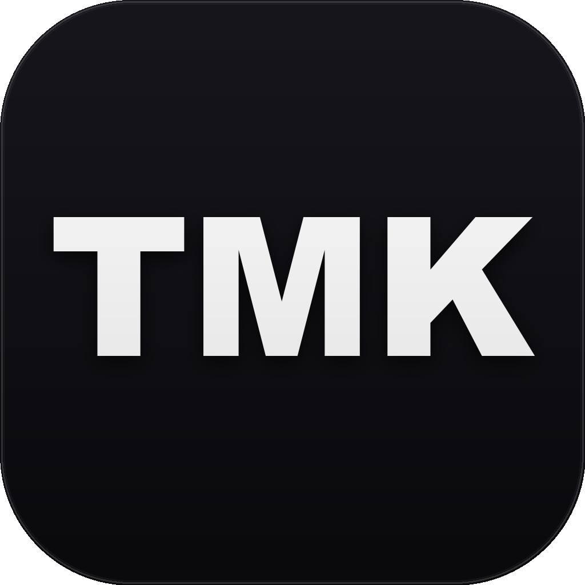

<p align="center">
  
</p>

<h1 align="center">TMK Studio — Apple Native Portfolio Showcase</h1>

<p align="center">
  <strong>Website portfolio tĩnh giới thiệu hệ sinh thái ứng dụng Apple độc lập của TMK Studio (Trần Cường).</strong>
</p>

<p align="center">
  <a href="https://apps.apple.com/vn/developer/tran-cuong/id1869197483"></a>
  <a href="https://cloudflare.com"></a>
  
  
  
</p>

---

## 🌟 Giới thiệu

**TMK Studio** là studio phát triển sản phẩm độc lập bởi **Trần Cường**, tập trung xây dựng các ứng dụng bản địa (native) chất lượng cao trên nền tảng **iOS**, **iPadOS**, **watchOS** và **macOS**.

Website này là trang showcase chính thức, được xây dựng theo kiến trúc **Static Single Page Application** tối ưu hiệu năng tuyệt đối: không phụ thuộc framework nặng, không cần bước build, thời gian tải trang gần như tức thì, và sẵn sàng deploy trực tiếp trên **Cloudflare Pages** hoặc **GitHub Pages**.

---

## 📱 Hệ sinh thái ứng dụng TMK Studio

| Ứng dụng | Nền tảng | Thể loại | Điểm nổi bật & Triết lý | Tải về / Cài đặt |
| :--- | :---: | :---: | :--- | :---: |
| **Lời Xưa** | iOS 17+ | Education / Culture | Kho ca dao, tục ngữ, thành ngữ Việt. Thuật toán daily PRNG deterministic, tìm kiếm không dấu, gieo quẻ dân gian. | [App Store](https://tmkstudio.io.vn/loixua) |
| **TypeMate** | macOS 14+ | Productivity | Text Expander native tối ưu cho bộ gõ tiếng Việt (Telex/VNI/EVKey). Phím tắt `⌥⌘V` Spotlight style, an toàn dữ liệu. | [Tải bản DMG](downloads/TypeMate.dmg) |
| **Trạm Thiền Trà** | iOS 16+ | Lifestyle / Health | Thiền định qua nghi thức uống trà & nhật ký biết ơn phong cách Việt. SwiftData, 6 khung giờ động, privacy-first. | [App Store](https://tmkstudio.io.vn/thientra) |
| **Bus Chill** | iOS 17+ | Navigation | Báo thức ngủ quên trên xe buýt Hà Nội. Geofence 2 tầng + Live Activities + Apple Watch, GTFS SQLite offline-first. | [App Store](https://tmkstudio.io.vn/buschill) |
| **Fam Diary** | iOS 17+ | Lifestyle | Nhật ký số an toàn cho gia đình. Mã hoá AES-256 on-device, bảo vệ những kỷ niệm riêng tư nhất. | [App Store](https://tmkstudio.io.vn/famdiary) |
| **Paletto** | iOS 16+ | Utilities / Design | Trích xuất và kiến tạo bảng màu bằng thuật toán K-Means, kiểm tra độ tương phản WCAG 2.2, xuất 9 định dạng code. | [App Store](https://tmkstudio.io.vn/paletto) |
| **Cất Link** | iOS 17+ | Productivity | Save-for-do: biến link đọc sau thành hành động với Ý định + Thời điểm. Share Extension zero-overhead, dedup thông minh. | [App Store](https://tmkstudio.io.vn/catlink) |
| **Trang Trại Nhà Tôi** | iOS 17+ | Business / Finance | Sổ thu chi chăn nuôi offline-first cho hộ nhỏ (Vịt/Gà/Lợn). Tính giá hoà vốn, cân bán 2 pha Bì - Gộp, báo cáo Zalo 1 chạm. | [App Store](https://tmkstudio.io.vn/trangtrainhatoi) |

---

## 🏛️ Triết lý phát triển cốt lõi

1. **Local-first / Offline-first**: Mọi ứng dụng đều khởi chạy và hoạt động trơn tru khi không có internet. Dữ liệu thuộc quyền sở hữu của người dùng trên thiết bị cá nhân.
2. **Privacy by Design**: Không theo dõi vị trí, không IDFA, không quảng cáo rác, không yêu cầu tạo tài khoản phiền phức.
3. **Apple Native Experience**: Tận dụng tối đa các công nghệ mới nhất của Apple: SwiftUI, Swift 6, SwiftData, WidgetKit, Live Activities, App Intents, Dynamic Island.
4. **Thiết kế hướng đến người Việt**: Tối ưu chuẩn hoá tiếng Việt không dấu, tổng hợp giọng nói `vi-VN`, và giải quyết các nhu cầu thiết thực trong đời sống thường nhật.

---

## 📂 Cấu trúc thư mục

```
TMKStudio/
├── index.html                  # Landing page chính (Bento Grid 8 apps, Modal HIG, Filter, i18n)
├── 404.html                    # Trang fallback 404 phong cách Dark Theme TMK
├── _headers                    # Cấu hình Cache-Control & HTTP Security Headers (Cloudflare Pages)
├── .gitignore                  # Bỏ qua file rác macOS & cache cục bộ
├── downloads/
│   └── TypeMate.dmg            # Bản cài đặt Universal trực tiếp cho macOS (Chip M & Intel)
├── assets/
│   ├── css/
│   │   └── style.css           # Custom Glassmorphism, font-face & animations
│   ├── js/
│   │   └── app.js              # APPS_DATA, bộ lọc, i18n (VI/EN), Modal Dialog logic
│   ├── fonts/                  # DFVN Basteleur Display Fonts (Bold, Moonlight)
│   ├── icons/                  # Logo TMK Studio, Monogram SVG & icons 7 apps
│   ├── banners/                # Header banners hiển thị trong modal & bento
│   └── screens/                # Screenshots thực tế của các ứng dụng
└── docs/
    └── PORTFOLIO_OVERVIEW.md   # Tài liệu kiến trúc & phân tích chuyên sâu 7 app
```

---

## 🚀 Chạy cục bộ (Local Development)

Dự án là trang tĩnh thuần tuý, không yêu cầu `npm install` hay build step.

```bash
# Mở trực tiếp trên macOS:
open index.html

# Hoặc dùng máy chủ tĩnh nhẹ (tuỳ chọn):
npx serve .
# hoặc
python3 -m http.server 8080
```

---

## ☁️ Triển khai lên Cloudflare Pages

Dự án đã được cấu hình sẵn cho **Cloudflare Pages**:

1. Đăng nhập [Cloudflare Dashboard](https://dash.cloudflare.com/) > chọn **Workers & Pages**.
2. Chọn **Create application** > tab **Pages** > **Connect to Git**.
3. Chọn repo `CuongTran69/tmkstudio` và cấu hình:
   - **Framework preset**: `None`
   - **Build command**: *(để trống)*
   - **Build output directory**: `/` (hoặc `.`)
4. Bấm **Save and Deploy**. Cloudflare sẽ tự động áp dụng các tối ưu từ file `_headers` và kích hoạt CDN toàn cầu.

---

## 👤 Tác giả

**Trần Cường (TMK Studio)**
- **App Store**: [Trần Cường Developer Profile](https://apps.apple.com/vn/developer/tran-cuong/id1869197483)
- **GitHub**: [@CuongTran69](https://github.com/CuongTran69)
- **Email**: cuongtran17796@gmail.com

---

© 2026 TMK Studio. Thiết kế và phát triển độc lập bởi Trần Cường.
